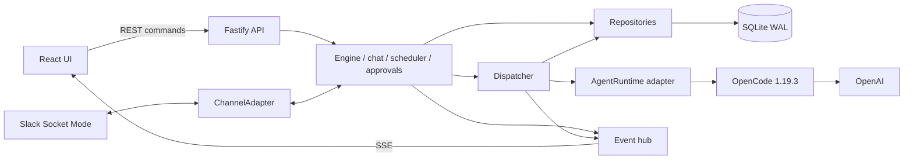

# Yuno — AI agent orchestration platform

Yuno lets you create AI agents, configure how they behave (personality, tools, schedules, memory, skills, approval rules and limits), connect them into visual workflows, and talk to one of them in Slack. Every agent turn runs on [OpenCode](https://opencode.ai), a real agent runtime. Agents call real tools, write real files, and hand work to each other through a durable message queue. Yuno owns the orchestration: routing, messages, approvals, guardrails and monitoring.

Demo video: [Yuno walkthrough (Loom)](https://www.loom.com/share/60954e1934794390a3e5729f18cde015) · Brief: [docs/brief.md](docs/brief.md) · Requirements traceability: [docs/requirements.md](docs/requirements.md)

## Status

Verified live on 2026-10-20 (OpenCode 1.19.3, `openai/gpt-5.4-mini`, Slack Socket Mode). Details and run IDs are in [docs/live-validation.md](docs/live-validation.md).

- **Multi-agent workflow, end to end.** The development pipeline went Coder → Reviewer (**rejected** with specific feedback) → Coder (fixed it) → Reviewer (**approved**) → human approval → Deployer. The deployed calculator works at `localhost:8080/<runId>/`.
- **Slack.** A human DMs the bound agent and gets real replies in its configured personality. It used its `webfetch` tool, saved a memory from Slack, and recalled it in a separate conversation.
- **Guardrails.** A run over an agent's daily cost cap was blocked before any tokens were used (`daily_cost_cap`).
- **Monitoring.** Agent status, live logs (including tool calls), every agent-to-agent and Slack message, run progress on the graph, and token and cost totals all update live.

## Quick start

Prerequisites: Git, Docker with Compose v2, and Make.

```sh
make up
```

That one command creates `.env` from `.env.example` if it is missing, builds the app and the pinned OpenCode image, and starts three containers: `app` (API and UI on [localhost:3000](http://localhost:3000)), `opencode` (the runtime, private to the Compose network) and `preview` (deployed agent output on [localhost:8080](http://localhost:8080)).

For real agent turns, put your OpenAI key in `.env` as `OPENAI_API_KEY` and run `make up` again. Keep credentials out of prompts and workspaces.

Then:

1. Open **Templates** and load **Development pipeline**. It creates a Coder, a Reviewer and a Deployer, and an editable workflow.
2. Click **Run** (the Run workflow dialog) and give it a task, for example: _Build a single-page tip calculator (index.html with inline CSS and JS): inputs for bill amount, tip percent, and number of people; show the total tip, the grand total, and the amount each person pays; validate that inputs are positive numbers._
3. Watch **Monitor** or the run page. Approve the deploy step in **Approvals**, then open the preview link in the run result.

To explore without model calls, use the scripted fake runtime: `RUNTIME=fake make up`. It does not execute tools or prove live integration.

`make logs` follows container logs. `make down` stops the stack and keeps data. `make reset` asks for confirmation, then deletes all application data and runtime sessions.

### Slack

1. Create a Slack app from [the manifest](docs/slack-app-manifest.yaml) (api.slack.com → Create New App → From a manifest). It enables Socket Mode, direct messages and app mentions, so no public URL is needed.
2. Install it to your workspace and copy the **Bot User OAuth Token** (`xoxb-…`) into `SLACK_BOT_TOKEN`.
3. Under **Basic Information → App-Level Tokens**, create a token with `connections:write` and copy it (`xapp-…`) into `SLACK_APP_TOKEN`.
4. Restart the app (`docker compose up -d --force-recreate app`).
5. In Yuno, open an agent's **Channels** tab and enable its Slack binding (one agent at a time). The status bar shows **Slack: connected**. DM the bot or mention it.

### Local development without Docker

Prerequisites: Node 24 and pnpm 12.14.0 (the `packageManager` pin).

```sh
pnpm install --frozen-lockfile
pnpm dev
```

Open the Vite URL (normally `http://localhost:5173`); API requests proxy to port 3000. Local development defaults to the fake runtime. The server does not load `.env` by itself. For a real runtime, run `opencode-ai@1.19.3` with `opencode serve --hostname 127.0.0.1 --port 4096` and start Yuno with `RUNTIME=opencode`, `OPENCODE_URL=http://127.0.0.1:4096` and an absolute `DATA_DIR`. The server and OpenCode must see the same absolute workspace paths and a shared writable `/deployments` directory.

## Key metrics

The brief names four impact metrics. These are the measured values from the live runs on 2026-10-20 (see [docs/live-validation.md](docs/live-validation.md)).

| Metric                                           | Result                                                                                                                                                                                                                                                                               |
| ------------------------------------------------ | ------------------------------------------------------------------------------------------------------------------------------------------------------------------------------------------------------------------------------------------------------------------------------------ |
| Configurable dimensions per agent                | **20**, from one shared list (see [Agent configuration](#agent-configuration))                                                                                                                                                                                                       |
| Time from zero to a working multi-agent workflow | **One command** (`make up`), **one click** to load a template (21 ms; creates the agents and the workflow), and the measured feedback-loop run **completed in 2 min 11 s**, including a rejection loop and a human approval                                                          |
| End-to-end task completion rate                  | **100%** of live runs that were not deliberately blocked: 2 of 2 workflow runs and 3 of 3 Slack and UI chat turns completed. One further run was blocked on purpose by the cost guardrail                                                                                            |
| Agent-to-agent message reliability               | **11 of 11** messages acknowledged in the latest session (4 agent-to-agent handoffs, 4 Slack, 3 UI), **0 retries, 0 dead letters**. Crash recovery, retry with backoff, de-duplication and dead-lettering are covered by automated tests in [`apps/server/test/`](apps/server/test/) |

The sample is one working day, so the completion rate shows the happy path works on the real runtime. The failure paths are proven by tests rather than by volume.

## Architecture



Three layers, kept separate as the brief asks:

- **UI** (`apps/web`): React, React Flow for the builder and run graph, TanStack Query. It talks to the server only through `apps/web/src/api/` (REST for commands, SSE for live updates).
- **Runtime and channel integration** (`apps/server/src/runtime`, `apps/server/src/channels`): two small interfaces, `AgentRuntime` and `ChannelAdapter`. Only the OpenCode adapter imports the OpenCode SDK, and only the Slack adapter imports Bolt. Fake implementations of both drive the tests.
- **Persistence** (`apps/server/src/db`): SQLite in WAL mode through Drizzle. SQL lives only in repositories. Migrations run on startup.

**How a workflow runs.** Starting a run stores a copy of the workflow graph and a durable start message. The dispatcher claims the message, checks guardrails and approval gates, compiles the agent's current configuration (role, prompt, memory, skills, tool permissions) and runs one turn on OpenCode. When the turn ends, acknowledging the message and writing the next handoff happen in one database transaction. Outgoing edges are evaluated in order, and the first match wins. Conditions are `always`, `approved`, `rejected` (read from the reviewer's `VERDICT:` line), or "contains" text. Feedback loops are capped by `maxIterations`.

**Reliability.** A failed turn retries after 10 and then 20 seconds; the third failure dead-letters the message and fails the run visibly. On startup, interrupted messages return to the queue. Idempotency keys prevent duplicate handoffs. One honest limit: a tool call can run twice if the server crashes mid-turn, before the result is committed.

**Live updates.** The server pushes events over SSE. When the Monitor opens, it loads the last 200 persisted log entries, then appends live events. On reconnect, the UI reloads state from the API.

More detail: [plain-English walkthrough](docs/system-explained.md), [diagrams](docs/diagrams/), [architecture](docs/architecture.md), [decision log](docs/decisions.md), [OpenCode API spike](docs/spikes.md), [design questions](docs/questions.md).

## Runtime choice: OpenCode, and the trade-off

The brief asks for one of OpenClaw, OpenCode or Goose as the execution engine. The key fact behind the choice: **none of the three orchestrates a multi-agent workflow with conditions and feedback loops.** OpenClaw runs several isolated agents side by side, and its "Agent Teams" coordination feature was still an RFC when we checked (2026-10-19). OpenCode and Goose run one agent session at a time. So in every case Yuno has to own the workflow engine, message queue, approvals and guardrails. The real question was which runtime is easiest to drive from our code, one turn at a time, with each agent's configuration applied.

|                                      | OpenClaw                                                                                                                                 | **OpenCode (chosen)**                                                                                                                              | Goose                                                                             |
| ------------------------------------ | ---------------------------------------------------------------------------------------------------------------------------------------- | -------------------------------------------------------------------------------------------------------------------------------------------------- | --------------------------------------------------------------------------------- |
| How we would drive it                | A WebSocket gateway built around chat channels                                                                                           | `opencode serve`: an HTTP API with an OpenAPI spec, a typed JS SDK and an SSE event stream                                                         | The `goosed` REST server, built mainly to back the desktop app, or ACP over stdio |
| Per-agent config from our UI         | Agents live in gateway config and workspace files (SOUL.md, MEMORY.md); community docs reported that adding one needed a gateway restart | System prompt and model per message; permissions per workspace directory and per session                                                           | Recipes and extension config per session                                          |
| Built-in channels, scheduler, memory | **Yes**, its biggest strength                                                                                                            | No                                                                                                                                                 | No channels; extensions and recipes                                               |
| Who owns state                       | OpenClaw's own SQLite database (a second source of truth)                                                                                | Sessions only; Yuno's database stays the source of truth                                                                                           | Sessions only                                                                     |
| Tools and permissions                | Not evaluated in depth                                                                                                                   | Shell, file edit and patch, web fetch, each with allow / ask / deny permissions, permission events, and tokens and cost on every assistant message | MCP extensions (very flexible)                                                    |
| Language                             | TypeScript                                                                                                                               | TypeScript                                                                                                                                         | Rust core                                                                         |

**What we gained.** A clean adapter. One turn is: create or reuse a session, send the prompt with the agent's system prompt and model, stream events, read usage. Permission events map directly onto the brief's "requires approval" rule: OpenCode asks, Yuno puts the request in the approval inbox, and the human's answer goes back to the runtime. Yuno's own database stays the single source of truth for agents, workflows and history. The brief's own example workflow (Coder, Reviewer, Deployer) is exactly what OpenCode is good at, and its per-message cost data powers the cost guardrails.

**What we gave up.** OpenClaw's built-in multi-channel gateway, scheduler and memory. We built those ourselves: the Slack adapter, a croner-based scheduler, and platform-owned memory compiled into each prompt. That was more work, but these are graded features, and owning them means they are configured from Yuno's UI instead of another tool's files. We also run non-coding agents (the Slack assistant, the research pipeline) on a coding-oriented runtime. They use its web fetch and file tools, which works well for these tasks.

**Risks we found, and how we contained them.**

- **API drift.** OpenCode's docs had v1 and v2 config formats, and the website's permission endpoint differed from the live server. We pinned the CLI and SDK to exactly **1.19.3** and ran a spike against the live OpenAPI spec before writing the adapter ([docs/spikes.md](docs/spikes.md)).
- **A permission trap.** The spike showed that per-message tool switches become "allow" rules that silently override "ask", so approvals would not have been enforced. The adapter expresses tool policy only through permissions, re-applied to every reused session. Live probes confirmed ask then reject, blocked commands, and denial outside the workspace.
- **Not a sandbox.** OpenCode's permissions are runtime rules, not an operating-system sandbox. The real boundary is the `opencode` container. Agents may write only inside their run's workspace; the Deployer gets one explicit extra grant for its own `/deployments/<runId>/` folder.

## Language choice: TypeScript

TypeScript runs on both the Node 24 server and the React UI, with strict type checking and shared zod schemas in `packages/shared`, so the API contract is defined once and validated on both sides. It matches OpenCode's SDK, so the adapter uses generated types instead of hand-written HTTP calls. Fastify serves the API, React Flow powers the visual builder, and Drizzle with SQLite gives a real database without another service to install, which keeps setup to one command. SSE is enough for live updates, because the browser only needs pushed events; commands go over REST.

The trade-off: this is a single-server design. One dispatcher owns one SQLite queue, and Slack Socket Mode suits a single instance. Scaling out would mean Postgres, a real queue and the Slack Events API.

## Agent configuration

<!-- dimensions:start -->

Yuno exposes **20 configurable dimensions per agent**, defined in [the shared list](packages/shared/src/dimensions.ts). The editor shows the same count, grouped by setting, and how many are set on the current agent.
<!-- dimensions:end -->

The agent editor groups them into tabs: **Basics** (name, role, system prompt, model), **Tools & permissions** (bash, edit and web fetch, each allow / ask / deny; blocked commands; **Can deploy**), **Channels** (Slack binding and status), **Schedules** (cron or interval, in UTC), **Memory** (facts that persist across sessions; agents add them with `REMEMBER:` lines), **Skills** (reusable step-by-step procedures), **Guardrails** (run cost cap, daily cost cap, turns per hour, turn timeout) and **Test chat**.

Counts treat enabled tools, bindings and schedules, non-deny permissions, nonempty text and collections, and valid guardrail values (including defaults) as set. Run `pnpm dimensions:update` after editing the shared list; lint checks that this README stays in sync.

Allowed models are `openai/gpt-5.4-mini` (default), `openai/gpt-5.4-nano` and `openai/gpt-5-mini` (the 2.5M tokens/day complimentary pool), and `openai/gpt-5.4` (the 250K/day pool). Costs in the UI are estimates at list price.

## Adding a template

1. Copy a JSON file in `templates/` and give it a unique slug `id`, a name and a description.
2. Define the agents in `agents` and the graph nodes, which reference agents by their exact `agentName`. [`TemplateSchema`](packages/shared/src/workflows.ts) is the contract. Include node positions, a valid `startNodeId`, ordered edges and a bounded `maxIterations`.
3. Make sure every edge endpoint and agent reference exists, each node has at most one `always` edge, and an end node is reachable. `approved` and `rejected` edges need a reviewer whose reply ends with `VERDICT: APPROVED` or `VERDICT: REJECTED`.
4. Restart (`make up` rebuilds and packages the JSON). Templates are validated at startup; invalid JSON or duplicate IDs fail startup with a clear error. Load it from the Templates page and edit the resulting workflow.
5. Add a load test next to [`templates.test.ts`](apps/server/test/templates.test.ts).

Loading never overwrites existing agents with the same name. If the template is already loaded, the Templates page offers **Open existing** or **Load a copy**.

## Adding a channel

Slack is the only channel today, and the shared schemas and database constraints name it explicitly, so a second channel is a coordinated change, not just a new adapter.

1. Implement [`ChannelAdapter`](apps/server/src/channels/types.ts), following `channels/slack/`. Map each incoming message to a stable external event ID, conversation ID, sender, sender name and text; ignore the bot's own messages; keep the provider SDK inside the adapter.
2. Extend the shared channel schemas and binding validation, and add a database migration for the new channel type. Update UI labels wherever Slack is named.
3. Reuse [`chat.ts`](apps/server/src/domain/chat.ts) for durable acceptance: de-duplication, conversation ownership, the inbound message and run creation all commit before the provider is acknowledged. Bound every provider call with a timeout and show delivery failures. Never rerun a model just because posting a reply failed.
4. Wire it in `index.ts`, read credentials only in `config.ts`, and list placeholders in `.env.example`.
5. Add network-free tests with the fake channel pattern, then verify reconnect and retry behavior against the real provider.

## Development workflow

`pnpm install --frozen-lockfile` installs the local Husky hooks. CI sets `HUSKY=0` and runs its checks independently.

| Piece                           | When it runs       | What it does                                             | If it fails                                                       |
| ------------------------------- | ------------------ | -------------------------------------------------------- | ----------------------------------------------------------------- |
| pre-commit (lint-staged)        | `git commit`       | ESLint fixes and Prettier on staged files only           | Fix errors, stage and commit again                                |
| commit-msg (commitlint)         | `git commit`       | Requires Conventional Commits such as `feat: add agent`  | Rewrite the message                                               |
| pre-push                        | `git push`         | Typechecks and tests the project                         | Fix before pushing                                                |
| CI lint, typecheck, test, build | Branch/MR pipeline | Frozen install and all existing quality gates            | Open the failed job in the MR pipeline; use `glab ci trace <job>` |
| CI gitleaks                     | Branch/MR pipeline | Scans for committed secrets                              | Remove the secret from history; rotate it if exposed              |
| CI audit                        | Branch/MR pipeline | Reports high dependency advisories, non-blocking         | Review the advisory; record the result                            |
| CI commitlint                   | MR pipeline        | Checks every commit since the MR base                    | Correct invalid messages on your branch                           |
| CI compose                      | Branch/MR pipeline | Validates Compose using example configuration, no daemon | Fix configuration and rerun                                       |

Escape hatches: `git commit --no-verify` skips hooks for one commit; `HUSKY=0` disables hooks. CI still checks the branch. Do not use them to bypass required quality gates.

`main` requires a merge request with a successful pipeline, and force-pushes are blocked. Pipelines run on a project runner (`yuno-mac`, Docker on the owner's Mac), so CI runs only while that machine is on; a team would use a hosted runner.

How this repo was built: Claude handled planning, architecture, decisions and review; Codex handled implementation, tests, commits and merges, with tester, verifier, reviewer and auditor subagents defined in [`.codex/agents/`](.codex/agents/). See the [AI usage log](docs/ai-log.md) and the [build reports](docs/night-report.md).

## Checks, security and limits

```sh
pnpm run ci   # lint, typecheck, test, build
```

There are over 340 automated tests covering agent creation, workflow routing, durable delivery and recovery, guardrails, approvals, scheduling, channels, templates and the UI. Normal tests use fake adapters and never call OpenAI or Slack. `LIVE_TESTS=1` opts into the live runtime test; CI never sets it.

- **Local use only.** There is no authentication. The UI and preview bind to loopback, and OpenCode is private to the Compose network. Do not expose it publicly.
- **Tool rules are not an OS sandbox.** The `opencode` container is the boundary.
- **Costs are estimates** at list price, not billing figures. Memory is included in full in every prompt, so a very long memory would need retrieval.
- **Slack replies have no durable outbox.** A crash between saving a reply and posting it can leave a "thinking…" placeholder.
- **Single process.** One server and one SQLite database; see the language trade-off above.
- Runs created before the graph-snapshot migration display the current workflow, with a notice.
