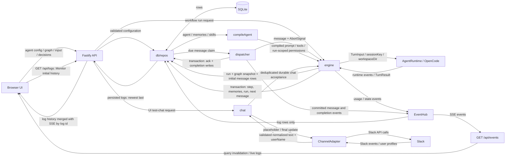

# Data flow

_Last updated: 2026-10-20 - Show normalized Slack text and persisted sender display metadata._

Runtime session IDs persist in `runtime_sessions`; OpenCode's own sessions persist in its volume. Full prompts and replies are stored in message/step rows, not logs. SSE has no replay or durable outbox: reconnect refreshes authoritative REST queries. Slack delivery handles are process-local, so persistence and delivery are separate guarantees.

Human message rows retain `fromId` and optional `fromName` display metadata. MessageTrail uses these names and agent configuration names for sender/recipient labels; a chat reply's human recipient is inferred for display from the same run and conversation, falling back to the latest prior human message in that conversation.

On open, Monitor loads the last 200 persisted logs through `GET /api/logs` (validated limit, maximum 500). It merges history with SSE logs by log ID, sorts oldest first, and displays up to 500 entries.

Workflow runs persist their graph at start; the engine routes and the run detail UI draws from that snapshot. Older runs without a snapshot fall back to the current workflow graph, with a notice in the run view. `compileAgent` receives the run ID and includes the deployment directory only when `canDeploy` is enabled.
