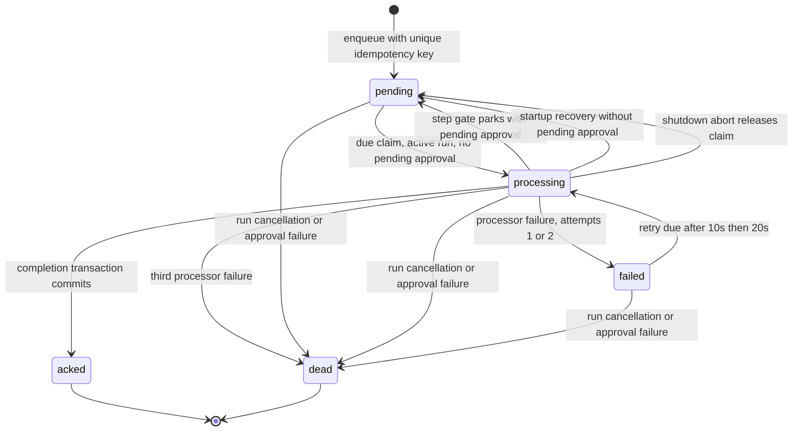

# Message lifecycle

_Last updated: 2026-10-20 - Match queue transactions, retries, parking and recovery._

`failed` is directly claimable when its deadline passes; it does not first transition through `pending`. Approval parking leaves the message pending but excludes it from claims until the gate is approved. Interrupted tool approvals instead fail closed on startup (`approval_interrupted`).

Acking and next-message creation share a SQLite transaction. Durable message dedupe does not guarantee exactly-once external tool effects: a crash after a tool side effect and before commit may replay the turn. One dispatcher owns a database; concurrency is at most four messages globally and one per agent.

Policy-terminal turns can ack their input while failing the run; message status and run status are separate. Chat reply rows are inserted already acked rather than passing through the queue.
