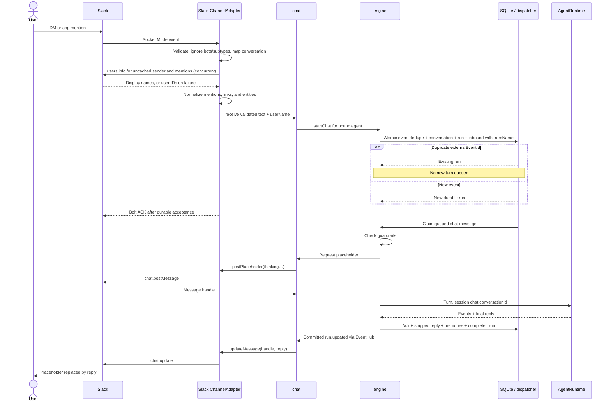

# Slack chat

_Last updated: 2026-10-20 - Show Slack name resolution and normalized inbound text before durable acceptance._

Slack API calls have a 15-second timeout. Rejected inbound persistence is not ACKed so Slack may retry. UI test chat uses the same durable engine path without Slack delivery.

Name lookups share cached promises, capped at 256 users with FIFO eviction and cleared on stop. Lookup failures remain cached as user IDs until eviction or stop and appear in channel status. Normalized text reaches storage and the agent; `fromName` is display metadata, while `fromId` keeps the original user ID. UI test chat supplies `You (UI)` as the sender name.

Delivery handles live only in memory. A crash after persistence can leave a stale placeholder, and failed final delivery is logged without rerunning the model. Failed/cancelled runs replace a known placeholder with a visible failure. Missing credentials leave Slack unconfigured.
