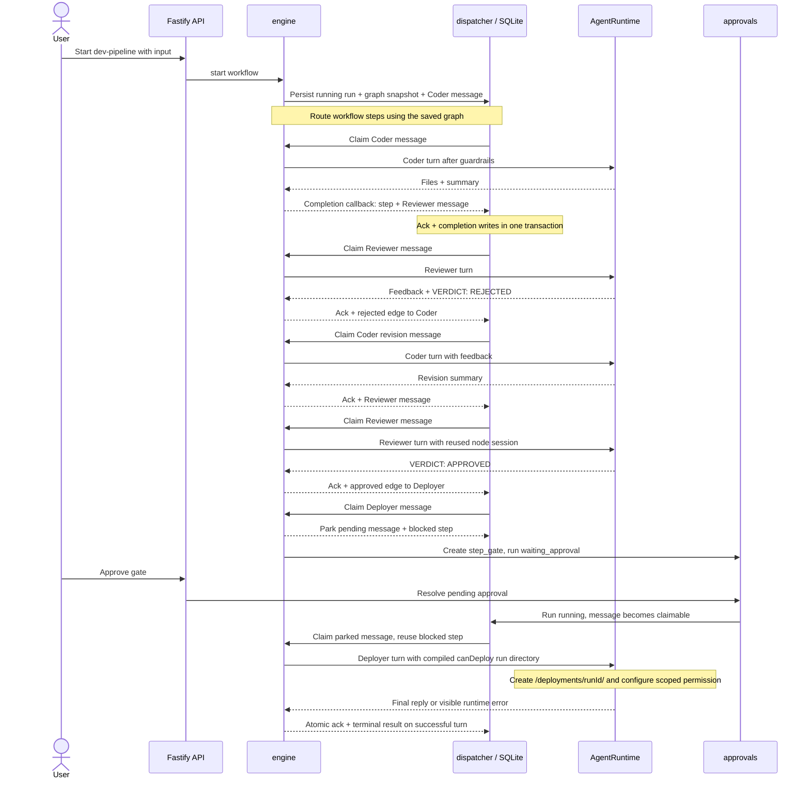

# Development workflow run

_Last updated: 2026-10-20 - Show graph snapshot routing and the run-scoped deploy grant._

Each node is bounded by `maxIterations` (template default 6). Edge order is first-match. Missing review verdict routes as rejected once, then fails if repeated. A rejected/expired human gate fails the run; it does not take the review rejection edge.

The template Deployer has `canDeploy: true`. Its compiled prompt and OpenCode policy permit `/deployments/<runId>/`; other outside directories remain denied by policy. The app and OpenCode share this deployment mount with the preview container. Fake runtime replies do not prove files were deployed, and the policy is not an operating-system sandbox.
