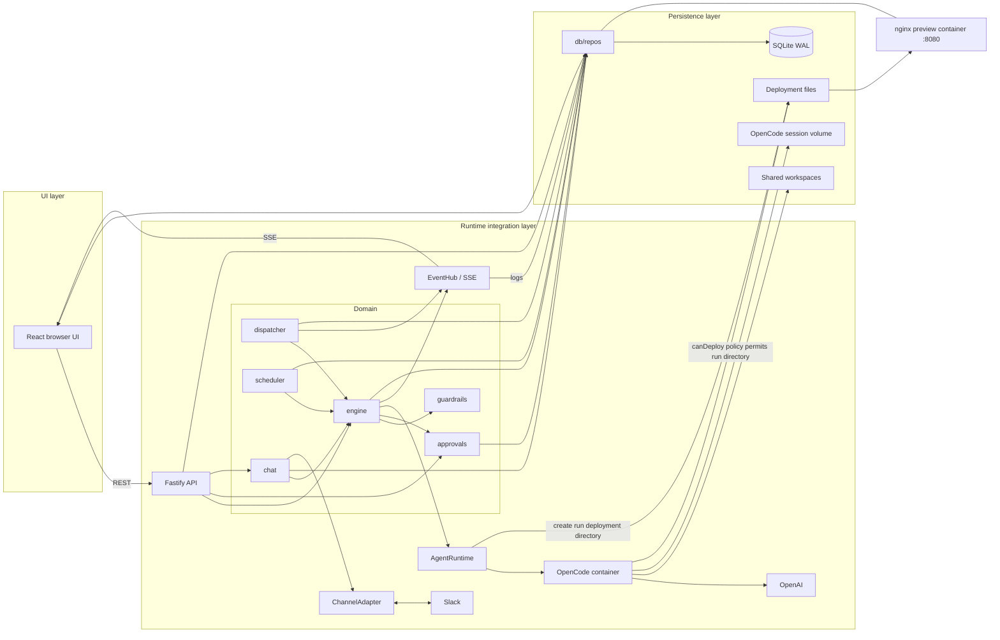

# System overview

_Last updated: 2026-10-20 - Show run-scoped deployment policy and the shared deployment mount._

Fake mode substitutes a deterministic `AgentRuntime`; absent Slack credentials leave the channel unconfigured. The app serves the built web UI on port 3000. OpenCode has no published host port.

The app and OpenCode share `/deployments`; nginx serves the same files read-only. For agents with `canDeploy`, the adapter creates `/deployments/<runId>/` and configures an outside-workspace exception for that run directory. This depicts configured permissions, not a verified live deployment or operating-system sandbox.
